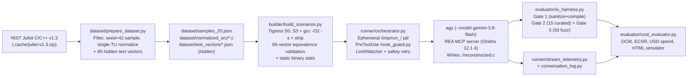

# Test Scenario Specification: Tigress Obfuscation vs. REA Native Binary Agent (`obf-agent-bench`)

> **Experiment ID:** `tigress_vs_rea_juliet20_io_cost`  
> **Suite Matrix:** 20 NIST Juliet v1.3 C programs × 4 Tigress obfuscation scenarios = **80 benchmark runs**  
> **Agent Under Test:** `gemini-3.8-flash` via Antigravity CLI (`agy`) operating strictly under the **REA (Reverse Engineer Anything)** MCP server backed by Ghidra `12.1.4`  
> **Primary Benchmark Root:** `Experimentation/obf-agent-bench/`

---

## 1. Scenario Overview & End-to-End Architecture

The benchmark evaluates how source-level C obfuscation (Control-Flow Flattening and Data/Arithmetic Mixed Boolean-Arithmetic encoding via **Tigress**) affects an autonomous reverse-engineering agent reconstructing clean, compilable, I/O-equivalent C11 source code (`./reconstructed.c`) from stripped x86-64 ELF binaries (`./chal`).

Performance is evaluated across two complementary axes:
1. **Axis 1 — Behavioral I/O Equivalency (`Experimentation/obf-agent-bench/evaluator/io_harness.py`):** Can the agent still produce a safe, cleanly compiling binary whose behavior on 65 deterministic boundary and differential-fuzz inputs is identical (`stdout`, `stderr`, exit code) to `./chal`?
2. **Axis 2 — Agentic Cost & Effort Telemetry (`Experimentation/obf-agent-bench/runner/stream_telemetry.py`, `cost_evaluator.py`):** Even when reconstruction succeeds, how much extra LLM token spend (USD), reasoning tokens, context window pressure, REA MCP calls/errors, conversation turns, wall-clock time, and empirical `./chal` runtime probes does obfuscation force?



---

## 2. Dataset Specification: 20 NIST Juliet v1.3 Programs

Sample selection and normalization are deterministic under `random_seed: 42` (`Experimentation/obf-agent-bench/configs/experiment.yaml`) in `Experimentation/obf-agent-bench/dataset/prepare_dataset.py`.

### 2.1 Deterministic Candidate Filtering Rules
From `.cache/juliet-v1.3.zip`, `candidate_files()` selects C testcases matching **all** of the following predicates:
1. **Filename & Structure:** Path matches `/testcases/CWE` and ends with `_01.c` (Flow Variant `01` baseline), includes only `std_testcase.h` (no auxiliary local headers), and reads input via `fscanf(stdin, ...)`.
2. **Supported Scalar Data Type:** Declares a primary `data` variable matching `^\s*(unsigned int|int64_t|int|short|char)\s+data;`.
3. **Deterministic & Self-Contained Scope:** Excludes any source (after stripping Juliet's boilerplate `srand( (unsigned)time(NULL) )`) containing non-deterministic, heap, filesystem, process, wide-char, struct, or network APIs matched by:
   ```regex
   \b(rand|time|malloc|alloca|ALLOCA|pthread\w*|wchar_t|fopen|socket|system|exec\w*|getenv|free|
      memcpy|strcpy|strcat|memset|strncpy|new|twoIntsStruct|abort|assert)\b
   ```
4. **Allowed Output Sinks (`ALLOWED_PRINTERS`):** Only uses standard Juliet `io.c` line printers: `printLine`, `printIntLine`, `printLongLine`, `printLongLongLine`, `printUnsignedLine`, `printShortLine`, `printHexCharLine`, `printHexUnsignedCharLine`, `printSizeTLine`, `printDoubleLine`, `printFloatLine`.

### 2.2 Stratified CWE Breakdown (`n = 20`)
| CWE Family | Sample Count | Share | Fault / Semantic Focus |
| :--- | :---: | :---: | :--- |
| `CWE190_Integer_Overflow` | 9 | 45% | Signed/unsigned integer addition, multiplication, square, pre-increment overflow |
| `CWE191_Integer_Underflow` | 6 | 30% | Signed/unsigned subtraction, negative multiplication, pre/post-decrement underflow |
| `CWE197_Numeric_Truncation_Error` | 3 | 15% | Precision-losing casts (`int -> char`, `int -> short`, `short -> char`) |
| `CWE369_Divide_by_Zero` | 2 | 10% | Guarded vs. unguarded integer division (`/`) and modulo (`%`) |
| **Total** | **20** | **100%** | — |

### 2.3 Complete 20-Sample Manifest (`dataset/samples_20.json`)
| # | Sample ID | CWE Family | Data Type | `fscanf` Format | Primary Sink | Juliet Upstream Path |
| :---: | :--- | :--- | :--- | :--- | :--- | :--- |
| 1 | `CWE190_Integer_Overflow__char_fscanf_add_01` | `CWE190_Integer_Overflow` | `char` | `"%c"` | `printHexCharLine` | `C/testcases/CWE190_Integer_Overflow/s01/CWE190_Integer_Overflow__char_fscanf_add_01.c` |
| 2 | `CWE190_Integer_Overflow__char_fscanf_square_01` | `CWE190_Integer_Overflow` | `char` | `"%c"` | `printHexCharLine` | `C/testcases/CWE190_Integer_Overflow/s01/CWE190_Integer_Overflow__char_fscanf_square_01.c` |
| 3 | `CWE190_Integer_Overflow__int64_t_fscanf_add_01` | `CWE190_Integer_Overflow` | `int64_t` | `"%" SCNd64` | `printLongLongLine` | `C/testcases/CWE190_Integer_Overflow/s01/CWE190_Integer_Overflow__int64_t_fscanf_add_01.c` |
| 4 | `CWE190_Integer_Overflow__int64_t_fscanf_multiply_01` | `CWE190_Integer_Overflow` | `int64_t` | `"%" SCNd64` | `printLongLongLine` | `C/testcases/CWE190_Integer_Overflow/s01/CWE190_Integer_Overflow__int64_t_fscanf_multiply_01.c` |
| 5 | `CWE190_Integer_Overflow__int_fscanf_multiply_01` | `CWE190_Integer_Overflow` | `int` | `"%d"` | `printIntLine` | `C/testcases/CWE190_Integer_Overflow/s03/CWE190_Integer_Overflow__int_fscanf_multiply_01.c` |
| 6 | `CWE190_Integer_Overflow__int_fscanf_square_01` | `CWE190_Integer_Overflow` | `int` | `"%d"` | `printIntLine` | `C/testcases/CWE190_Integer_Overflow/s03/CWE190_Integer_Overflow__int_fscanf_square_01.c` |
| 7 | `CWE190_Integer_Overflow__char_fscanf_preinc_01` | `CWE190_Integer_Overflow` | `char` | `"%c"` | `printHexCharLine` | `C/testcases/CWE190_Integer_Overflow/s07/CWE190_Integer_Overflow__char_fscanf_preinc_01.c` |
| 8 | `CWE190_Integer_Overflow__short_fscanf_preinc_01` | `CWE190_Integer_Overflow` | `short` | `"%hd"` | `printIntLine` | `C/testcases/CWE190_Integer_Overflow/s07/CWE190_Integer_Overflow__short_fscanf_preinc_01.c` |
| 9 | `CWE190_Integer_Overflow__unsigned_int_fscanf_preinc_01` | `CWE190_Integer_Overflow` | `unsigned int` | `"%u"` | `printUnsignedLine` | `C/testcases/CWE190_Integer_Overflow/s07/CWE190_Integer_Overflow__unsigned_int_fscanf_preinc_01.c` |
| 10 | `CWE191_Integer_Underflow__char_fscanf_multiply_01` | `CWE191_Integer_Underflow` | `char` | `"%c"` | `printHexCharLine` | `C/testcases/CWE191_Integer_Underflow/s01/CWE191_Integer_Underflow__char_fscanf_multiply_01.c` |
| 11 | `CWE191_Integer_Underflow__char_fscanf_sub_01` | `CWE191_Integer_Underflow` | `char` | `"%c"` | `printHexCharLine` | `C/testcases/CWE191_Integer_Underflow/s01/CWE191_Integer_Underflow__char_fscanf_sub_01.c` |
| 12 | `CWE191_Integer_Underflow__int64_t_fscanf_sub_01` | `CWE191_Integer_Underflow` | `int64_t` | `"%" SCNd64` | `printLongLongLine` | `C/testcases/CWE191_Integer_Underflow/s01/CWE191_Integer_Underflow__int64_t_fscanf_sub_01.c` |
| 13 | `CWE191_Integer_Underflow__unsigned_int_fscanf_postdec_01` | `CWE191_Integer_Underflow` | `unsigned int` | `"%u"` | `printUnsignedLine` | `C/testcases/CWE191_Integer_Underflow/s04/CWE191_Integer_Underflow__unsigned_int_fscanf_postdec_01.c` |
| 14 | `CWE191_Integer_Underflow__int_fscanf_predec_01` | `CWE191_Integer_Underflow` | `int` | `"%d"` | `printIntLine` | `C/testcases/CWE191_Integer_Underflow/s05/CWE191_Integer_Underflow__int_fscanf_predec_01.c` |
| 15 | `CWE191_Integer_Underflow__unsigned_int_fscanf_predec_01` | `CWE191_Integer_Underflow` | `unsigned int` | `"%u"` | `printUnsignedLine` | `C/testcases/CWE191_Integer_Underflow/s05/CWE191_Integer_Underflow__unsigned_int_fscanf_predec_01.c` |
| 16 | `CWE197_Numeric_Truncation_Error__int_fscanf_to_char_01` | `CWE197_Numeric_Truncation_Error` | `int` | `"%d"` | `printHexCharLine` | `C/testcases/CWE197_Numeric_Truncation_Error/s01/CWE197_Numeric_Truncation_Error__int_fscanf_to_char_01.c` |
| 17 | `CWE197_Numeric_Truncation_Error__int_fscanf_to_short_01` | `CWE197_Numeric_Truncation_Error` | `int` | `"%d"` | `printShortLine` | `C/testcases/CWE197_Numeric_Truncation_Error/s01/CWE197_Numeric_Truncation_Error__int_fscanf_to_short_01.c` |
| 18 | `CWE197_Numeric_Truncation_Error__short_fscanf_01` | `CWE197_Numeric_Truncation_Error` | `short` | `"%hd"` | `printHexCharLine` | `C/testcases/CWE197_Numeric_Truncation_Error/s02/CWE197_Numeric_Truncation_Error__short_fscanf_01.c` |
| 19 | `CWE369_Divide_by_Zero__int_fscanf_divide_01` | `CWE369_Divide_by_Zero` | `int` | `"%d"` | `printIntLine` | `C/testcases/CWE369_Divide_by_Zero/s01/CWE369_Divide_by_Zero__int_fscanf_divide_01.c` |
| 20 | `CWE369_Divide_by_Zero__int_fscanf_modulo_01` | `CWE369_Divide_by_Zero` | `int` | `"%d"` | `printIntLine` | `C/testcases/CWE369_Divide_by_Zero/s02/CWE369_Divide_by_Zero__int_fscanf_modulo_01.c` |

### 2.4 Single-Translation-Unit Normalization (`dataset/normalized_src/<sample_id>.c`)
Each raw Juliet source file (stored in gitignored `dataset/raw_juliet/`) is merged into a single self-contained translation unit by `normalize()` so Tigress can transform the whole program cleanly without header/linking variance:
1. Prepends standard C headers (`<stdio.h>`, `<stdlib.h>`, `<string.h>`, `<limits.h>`, `<stdint.h>`, `<inttypes.h>`, `<ctype.h>`) and `#define true 1` / `#define false 0`.
2. Removes `#include "std_testcase.h"` and strips Juliet's `#ifdef INCLUDEMAIN` time-seeded `main()` block.
3. Inlines only the `print*Line` implementations extracted from `C/testcasesupport/io.c` that the sample uses (always including `printLine`).
4. Appends a deterministic CLI wrapper `main(int argc, char *argv[])` supporting three execution modes (both `<sample_id>_good()` and `<sample_id>_bad()` exist per binary, exercising unguarded bad sinks as well as `goodG2B` and bounds-checked `goodB2G` paths):
   * `./chal good`: Runs `<sample_id>_good()` bracketed by `"Calling good()..."` / `"Finished good()"`.
   * `./chal bad`: Runs `<sample_id>_bad()` bracketed by `"Calling bad()..."` / `"Finished bad()"`.
   * `./chal` (no args or `"both"`): Runs `good()` followed by `bad()`.

---

## 3. Obfuscation Scenarios (`S0_Baseline` – `S3_Combined`)

Scenarios are built by `Experimentation/obf-agent-bench/builder/build_scenarios.py` using templates from `Experimentation/obf-agent-bench/configs/tigress_recipes.yaml`. All obfuscated sources (`build/<scenario>/<sample>/obfuscated.c`) remain outside the agent sandbox.

### 3.1 Common Tigress & Compiler Configuration
* **Tigress Environment:** `--Environment=x86_64:Linux:Gcc:4.6`
* **glibc C Parser Compatibility Defines:**
  ```text
  -std=gnu99 -D_Float32=float -D_Float64=double -D_Float128="long double"
  -D_Float32x=double -D_Float64x="long double" -U__SIZEOF_INT128__
  ```
* **64-bit Constant Staging:** `stage_for_tigress()` appends `ULL` suffixes to 19–20 digit decimal integer literals (`\b([0-9]{19,20})\b`) so Tigress's CIL C parser handles 64-bit bounds without truncation.
* **Function Scope & Cleanup:** `--Functions=%100` (all user functions + `main`), followed by `--Transform=CleanUp --CleanUpKinds=names,annotations --Functions=%100`.
* **Compilation & Stripping:**
  ```bash
  gcc -std=gnu99 -O2 -fno-stack-protector -fno-ident -s -w <src> -lm -o chal
  strip --strip-all --remove-section=.comment --remove-section=.note chal
  ```

### 3.2 Scenario Matrix
| Scenario | Recipe | Tigress Transformation Pipeline | Intended Decompilation Stress |
| :--- | :--- | :--- | :--- |
| **`S0_Baseline`** | `baseline` | None (`[]`) — compiled directly from `normalized_src/*.c` with `-O2 -fno-stack-protector -fno-ident -s` + `strip` | Baseline control (stripped optimized x86-64 ELF) |
| **`S1_Flatten`** | `flatten` | `--Transform=Flatten --FlattenDispatch=switch --Functions=%100` $\rightarrow$ `CleanUp` | Destroys lexical block structure via state-variable `switch` dispatcher loops and indirect jump tables |
| **`S2_EncodeData`** | `encode_data` | 1. `--Transform=InitOpaque --Functions=main --InitOpaqueStructs=array`<br>2. `--Transform=EncodeArithmetic --Functions=%100`<br>3. `--Transform=EncodeLiterals --Functions=%100`<br>$\rightarrow$ `CleanUp` | Replaces arithmetic/comparisons with opaque-array Mixed Boolean-Arithmetic (MBA) expressions and runtime-computed literals |
| **`S3_Combined`** | `combined` | 1. `InitOpaque (array)` on `main`<br>2. `Flatten (switch)` on `%100`<br>3. `EncodeArithmetic` on `%100`<br>4. `EncodeLiterals` on `%100`<br>$\rightarrow$ `CleanUp` | Forces the agent to recover flattened dispatcher state machines whose state transitions and case guards are themselves MBA/literal-encoded |

### 3.3 Build-Time Semantic Equivalence & Measured Binary Complexity (`n = 20` per Scenario)
Before any target enters `build/<scenario>/<sample>/`, `build_scenarios.py` executes `chal` on all 65 vectors (`curated` + `fuzz`) and compares `(returncode, stdout, stderr)` against both `S0_Baseline` and an unobfuscated reference built with `gcc -std=gnu99 -O0 -fwrapv` (to detect undefined-behavior shifts). Any mismatch marks `valid: false` so Tigress/UB defects are never blamed on the agent; all **80/80** builds in the suite passed validation (`valid: true`, `mismatches_vs_S0 = []`, `mismatches_vs_O0_fwrapv_reference = []`).

`binary_stats()` (`readelf -SW` + `objdump -d -M intel .text`) recorded the following cohort means across `build/build_summary.json`:

| Scenario | Mean ELF Size | Mean `.text` Bytes | Mean Insns | Cond. Jumps (`jcc`) | Indirect Jumps | Basic Block Est. | Cyclomatic Est. |
| :--- | :---: | :---: | :---: | :---: | :---: | :---: | :---: |
| `S0_Baseline` (`n=20`) | `14,360.0 B` | `677.8 B` | `167.8` (`1.00×`) | `11.2` | `2.0` | `38.3` | `14.2` |
| `S1_Flatten` (`n=20`) | `14,360.0 B` | `887.4 B` | `213.2` (`1.27×`) | `9.2` | `3.2` | `40.5` | `13.3` |
| `S2_EncodeData` (`n=20`) | `14,360.0 B` | `1,683.0 B` | `372.7` (`2.22×`) | `18.1` | `3.0` | `51.5` | `22.1` |
| `S3_Combined` (`n=20`) | `14,360.0 B` | `1,798.5 B` | `407.3` (`2.43×`) | `12.0` | `4.8` | `48.0` | `17.8` |

---

## 4. Agent Execution Environment, Sandbox Isolation & REA Protocol

Each `(scenario, sample_id)` target is executed in a completely separate headless `agy` process (`agy --dangerously-skip-permissions --mode=accept-edits --model gemini-3.8-flash --output-format stream-json -p <prompt>`), so no conversation carries memory or context from prior runs.

### 4.1 Per-Run Ephemeral Jail (`/tmp/run_<uuid>/`)
`Experimentation/obf-agent-bench/runner/orchestrator.py` creates a fresh directory `<jail_root>/run_<uuid>/` (default `jail_root: "/tmp"`) populated with **only**:
* `./chal` (`chmod 0755`) — the stripped target ELF binary copied from `build/<scenario>/<sample>/chal`
* `.agents/settings.json` — sets `model`, `agentMode: "accept-edits"`, `toolPermission: "always-proceed"`, and `permissions.allowCommands: ["gcc *", "./chal*", "./recon_bin*", "ls *", "cat *"]`
* `.agents/hooks.json` — registers `PreToolUse` (`matcher: "*"`, `timeout: 15`) invoking `runner/hook_guard.py --jail <jail> --log <run_dir>/hook_audit.jsonl --mcp-server rea`
* `.agents/skills/reverse-engineer-anything/` — copied from `/home/arch/.gemini/config/skills/reverse-engineer-anything`

The jail is removed in a `finally` block immediately after `./reconstructed.c` is copied out (unless `--keep-jail` is passed). Hidden ground truth (`dataset/normalized_src/`), obfuscated sources (`build/*/*/obfuscated.c`), and hidden test vectors (`dataset/test_vectors/`) never enter `/tmp/run_<uuid>/`.

### 4.2 PreToolUse Security Enforcement (`runner/hook_guard.py`)
Every tool invocation inside `agy` is checked before execution and logged as `{ts, tool, args, decision, reason}` to `<run_dir>/hook_audit.jsonl`:

| Rule Layer | Enforcement Behavior |
| :--- | :--- |
| **External Web / Browser Block** | Denies `FORBIDDEN_WEB_TOOLS` (`search_web`, `fetch_url`, `read_url_content`, `open_browser_url`, `read_browser_page`, `browser_subagent`, `capture_browser_screenshot`, `capture_browser_console_logs`, `click_browser_pixel`, `execute_browser_javascript`, `list_browser_pages`) and any `browser_*` tool to guarantee offline binary-only analysis. |
| **REA MCP Server Validation** | Allows `call_mcp_tool` (`ServerName == "rea"`), `mcp_rea_*`, and `REA_NATIVE_TOOLS`, provided any `path`/`target` argument passes `path_violation(jail)`. Requires `open_binary` to supply an absolute in-jail path (`<jail>/chal`). |
| **Strict REA Exclusivity (Shell)** | Denies `run_command` invoking alternative CLI disassemblers/debuggers matching `NON_REA_BINARY_CMDS`: `objdump`, `readelf`, `strings`, `nm`, `gdb`, `r2`, `rizin`, `radare2`, `hexdump`, `xxd`, `od`. Allows `gcc`, `./chal`, `./recon_bin`, `ls`, `cat`, etc. within the jail. |
| **Boundary & Env Guard** | Blocks `ENV_CMDS` (`env`, `printenv`, `/proc/*/environ`, `$HOME/$USER/$PATH/$PWD`), `~`/`$HOME` references, `..` parent traversal, and absolute paths outside `jail` unless under `SAFE_READ_PREFIXES` (`/usr/`, `/bin/`, `/lib/`, `/lib64/`, `/dev/null`, `/dev/stdin`, `/dev/stdout`, `/dev/stderr`, `/home/arch/.gemini/antigravity-cli/mcp/rea/`, `/home/arch/.gemini/config/skills/reverse-engineer-anything/` — matching both file paths inside and directory lookups without a trailing slash). |
| **Edit-Body False-Positive Immunity** | Skips path regex scanning inside code/edit text fields (`SKIP_KEYS`: `CodeContent`, `ReplacementContent`, `Description`, `Instruction`, `Content`, `TargetContent`, `Target`, `Replacement`, `Search`, `Pattern`, `toolAction`, `toolSummary`, `WaitMsBeforeAsync`) so C comments (`/* ... */`) and division (`a / b`) in edits do not trigger false denials while `Path` / `TargetFile` remain strictly jailed. |

### 4.3 REA Analysis Workflow (`runner/prompts/rea_task.md`)
The prompt frames the objective as a **deterministic differential recompilation and compiler-transformation benchmark** and instructs the agent to follow the 5-step REA workflow:
1. **Session Initialization:** `open_binary` (with `{chal_path}`) $\rightarrow$ `binary_overview`.
2. **Triage & Target Identification:** `list_procedures`, `list_strings` / `search_strings` (`pattern`), tracing from ELF `entry` to locate user `main` passed into `__libc_start_main`.
3. **Surgical Decompilation & Value Flow:** `procedure_pseudo_code`, `procedure_assembly` / `read_function_instructions`, `procedure_callees`, `procedure_callers`, and `xrefs` — explicitly skipping C runtime startup/teardown stubs (`_start`, `__libc_csu_init`, `frame_dummy`, `register_tm_clones`, `_INIT_0`, `_FINI_0`, `_DT_FINI`).
4. **Deobfuscation Discipline:** Reconstruct CFF state-machine `switch`/`goto` dispatchers into structured `for`/`while`/`if`/`else` statements and simplify MBA arithmetic/bit-hack identities into canonical C operators (`+`, `-`, `*`, `/`, `%`, `^`).
5. **Session Teardown & Deliverable:** Call `close_binary` and write self-contained C11 source to `./reconstructed.c` (compilable via `gcc -O2 reconstructed.c -o recon_bin`, preserving exact `argv`, `stdin`, `stdout`, and exit code behavior of `./chal`). External web lookups are explicitly prohibited.

### 4.4 Runtime Budget Watcher & Turn-1 Safety-Filter Retry (`runner/orchestrator.py`)
* **Stream Limiter (`LimitWatcher`):** Parses `agy`'s `--output-format stream-json` NDJSON in real time and sends `SIGTERM` to `agy`'s process group (`os.killpg`) if any configured finite budget is exceeded:
  * Default `configs/experiment.yaml` limits: `max_turns: 25`, `max_mcp_calls: 30`, `max_context_tokens: 128000`, `max_output_tokens: 16384`, `timeout_seconds: 300`.
  * CLI overrides: `--unlimited` sets `max_turns`, `max_mcp_calls`, and `timeout_seconds` to `None` (infinite); `--max-turns`, `--max-mcp-calls`, and `--timeout` accept `<= 0` for infinite per dimension. (`max_context_tokens` remains tracked/checked unless set `None`/`<= 0` in YAML.)
* **Turn-1 Safety-Filter Recovery:** If a run aborts on Turn 1 (`turns <= 1`, `mcp_calls == 0`, no `reconstructed.c`) with Gemini's content-filter refusal text (`SAFETY_FILTER_MARKERS`), `run_agent()` archives the refused attempt as `session_stream.safety_retry_<n>.jsonl` and `agy_stderr.safety_retry_<n>.log` and re-prompts once (`safety_filter_retries` default `1`) prepending `SAFETY_RETRY_PREAMBLE` explaining the benign synthetic NIST Juliet arithmetic context. Retries are tracked via `safety_filter_retries` in `run_metrics.json` and `telemetry.json`.

---

## 5. Dual-Axis Evaluation & Telemetry Specification

### 5.1 Axis 1 — Behavioral I/O Equivalency (`evaluator/io_harness.py`)
`io_harness.grade()` evaluates `./reconstructed.c` against the scenario's compiled `./chal` across **65 hidden test cases** (`dataset/test_vectors/<sample_id>.json`):

1. **Gate 1 — Static Sanitization & Clean Compilation:**
   * `static_sanitize()` strips C/C++ comments and string literals before scanning code tokens against `forbidden_tokens` (`system`, `popen`, `exec*`, `dlopen`, `__asm__`, `asm`), and checks non-comment string literals for references to `"chal"` (anti-oracle check).
   * Compiles cleanly with `gcc -O2 -Wall reconstructed.c -o recon_bin`. Any violation or compile failure stops grading early (`gate1.passed = false`, `Pass_IO = 0`).
2. **Gate 2 — Curated Boundary Vectors ($T_{\text{curated}}$, `15` cases per sample):**
   * Deterministic edge values constructed by `_boundary_values()` alternating `["bad"]` and `["good"]` arguments for integer types (`0, ±1, ±2, lo, lo+1, hi, hi-1, ±isqrt(hi), ±(isqrt(hi)+1), hi//2, hi//2+1, lo//2, lo//2-1, ±127, ±128, ±255, ±256, ±32767, ±32768, ±65535, ±65536` clipped to type range) or `CHAR_CURATED` (`15` representative byte values covering ASCII digits/letters, whitespace/newline, `0x00`, `0x01`, `0x7e`, `0x7f`, `0x80`, `0xfe`, `0xff`) for `char` samples.
3. **Gate 3 — Seeded Differential Fuzzing ($T_{\text{diff}}$, `50` cases per sample):**
   * Deterministically seeded per sample (`random.Random(f"{random_seed}:{sample_id}")`), choosing `argv` randomly across `[]` (both), `["good"]`, and `["bad"]`.
   * For `char`: uniform random byte `0..255`. For numeric types: **40%** uniform over `[lo, hi]`, **25%** boundary perturbations `base + randint(-3, 3)` around `{lo, hi, 0, isqrt(hi), hi // 2}`, **15%** small integers (`-300..300` signed / `0..600` unsigned), and **20%** malformed/whitespace/overflowing ASCII strings (`""`, `"abc"`, `"  "`, `"+"`, `"-"`, `"0x10"`, `"12abc"`, `" 7\n"`, `"\n\n5"`, `"99999999999999999999"`).

**Execution Sandboxing & Verdict (`common.run_binary`):**  
Both `./chal` and `./recon_bin` run side-by-side from a fresh neutral temp directory with minimal environment `{"PATH": "/usr/bin:/bin", "LC_ALL": "C"}`, `timeout_per_test_ms: 2000`, and POSIX `rlimit` caps (`RLIMIT_CPU=5s`, `RLIMIT_AS=512 MiB`, `RLIMIT_FSIZE=8 MiB`, `RLIMIT_NPROC=64`, `os.setsid()`). After Gate 1 passes, all 65 tests run regardless of intermediate mismatches to compute partial accuracy ($Acc_{\text{IO}} = \text{passed}/65$, logging up to 5 mismatches):

$$\text{Pass}_{\text{IO}} = \begin{cases} 1 & \text{if Gate 1 passes} \;\land\; \forall t \in (T_{\text{curated}} \cup T_{\text{diff}}),\; (\text{rc}, \text{stdout}, \text{stderr})_{\text{recon\_bin}}(t) \equiv (\text{rc}, \text{stdout}, \text{stderr})_{\text{chal}}(t) \;\land\; \neg \text{timed\_out} \\ 0 & \text{otherwise} \end{cases}$$

### 5.2 Axis 2 — Token, Cost, MCP & Effort Telemetry (`stream_telemetry.py` & `cost_evaluator.py`)

#### Token Accounting (`stream_telemetry.py`)
`parse_stream()` inspects every `DONE` `agent_response` turn (cross-checked against `result.usage`):
* $T_{\text{in}}$ (`input_uncached`): Sum of per-turn `input_tokens`.
* $T_{\text{cache}}$ (`input_cached`): Sum of per-turn `cache_read_tokens`.
* $T_{\text{think}}$ (`reasoning`): Sum of per-turn `thinking_tokens` (reported as a subset of `output_tokens` in `agy` streams).
* $T_{\text{out}}$ (`output`): Non-thinking completion tokens $\max(\text{output\_tokens} - T_{\text{think}}, 0)$.
* $T_{\text{peak}}$ (`peak_context`): $\max_t (T_{\text{in}, t} + T_{\text{cache}, t})$.
* $T_{\text{total}}$ (`total`): $T_{\text{in}} + T_{\text{cache}} + T_{\text{think}} + T_{\text{out}}$.

#### Configured Pricing & Research Metrics (`configs/experiment.yaml` & `cost_evaluator.py`)
Using `pricing_per_1m_tokens_usd` (official Google Gemini Developer API Standard Tier rates for `gemini-3.8-flash` active through Dec 31, 2026; post-promotional rates starting Jan 1, 2027 are `$1.50 / $0.15 / $7.50`):
* Uncached Input ($P_{\text{in}}$): **`$0.75` / 1M tokens**
* Prefix-Cached Input ($P_{\text{cache}}$): **`$0.075` / 1M tokens**
* Output & Reasoning ($P_{\text{out}}$): **`$3.75` / 1M tokens**

1. **Per-Run Monetary Cost ($C_{\text{run}}$):**
   $$C_{\text{run}} = \frac{T_{\text{in}} \cdot 0.75 + T_{\text{cache}} \cdot 0.075 + (T_{\text{think}} + T_{\text{out}}) \cdot 3.75}{10^6}$$
2. **Obfuscation Cost Multiplier ($OCM$):** Computed pairwise per sample $i$ vs. `S0_Baseline` for all runs (`ocm_all`, reporting both mean and median across tokens, dollar cost, MCP calls, and turns) and over passing pairs (`ocm_pass_only`), plus aggregate scenario mean ratios (`ocm_tokens`, `ocm_cost_usd`):
   $$OCM_{\text{tokens}}(S_k, i) = \frac{T_{\text{total}}(S_k, i)}{T_{\text{total}}(S_0, i)}, \qquad OCM_{\text{cost}}(S_k, i) = \frac{C_{\text{run}}(S_k, i)}{C_{\text{run}}(S_0, i)}, \qquad OCM_{\text{tools}}(S_k, i) = \frac{N_{\text{mcp}}(S_k, i)}{N_{\text{mcp}}(S_0, i)}$$
3. **Expected Cost per Successful Reconstruction ($ECSR$):** Unified accuracy-adjusted cost metric combining total scenario spend (including failed attempts) divided by passing binaries:
   $$ECSR_{\text{USD}}(S_k) = \frac{\sum_{i=1}^{N} C_{\text{run}}(S_k, i)}{\sum_{i=1}^{N} \text{Pass}_{\text{IO}}(S_k, i)}$$
4. **Tool Errors, Latency & Empirical Probes:** Tracks attempted (`mcp_calls`), succeeded (`mcp_calls_succeeded`), and errored (`mcp_calls_errored`, via `state == "ERROR"`, `tool_info.error`, or JSON `{"error": {...}}`) REA MCP calls per tool name, returned/error payload byte sizes, `other_tool_calls`, wall vs. LLM vs. MCP inference time (`latency`), and runtime `./chal` executions total vs. pre-deliverable-write (`hook_audit.chal_exec_calls`, `chal_exec_pre_write`).

### 5.3 Output Artifact Schema (`results/`)
| Location | Artifact | Contents |
| :--- | :--- | :--- |
| `results/<sc>/<sid>/` | `session_stream.jsonl` | Live `agy --output-format stream-json` NDJSON event stream (`safety_retry_<n>.jsonl` if retried) |
| `results/<sc>/<sid>/` | `transcript_full.jsonl` | Archived complete Antigravity brain transcript (`created_at`, full `thinking`, `tool_calls`, responses) |
| `results/<sc>/<sid>/` | `conversation_log.md` | Human-readable chronological turn, reasoning, MCP envelope, I/O grade, and hook audit Markdown log |
| `results/<sc>/<sid>/` | `hook_audit.jsonl` | Every PreToolUse sandbox allow/deny decision with arguments and reason |
| `results/<sc>/<sid>/` | `run_metrics.json` | Parsed stream metrics, per-turn token trace, MCP tool breakdowns, binary stats, cost USD, `safety_filter_retries` |
| `results/<sc>/<sid>/` | `telemetry.json` | Canonical merged Axis-1 + Axis-2 per-run evaluation contract consumed by `cost_evaluator.py` |
| `results/<sc>/<sid>/` | `reconstructed.c` & `io_result.json` | Agent-written C11 reconstruction + 3-gate I/O grading report (`gate1`, `gate2`, `gate3`, up to 5 failures) |
| `results/` | `benchmark_summary.json`, `summary_table.md`, `simulator.html` | Suite-level aggregate JSON, Markdown comparison matrix, and zero-CDN offline interactive SVG dashboard (`Cost USD`, `Accuracy & Tests`, `Token Growth`, `Agent Effort`, `Binary Obfuscation`, plus `What-If` filter sliders) |

---

## 6. CLI Reference & Reproducibility Guide

All commands run from `Experimentation/obf-agent-bench/`:

```bash
# 1. Verify agy CLI, 'rea' MCP registration, and Ghidra 12.1.4 environment
bash runner/verify_rea_env.sh

# 2. Prepare 20 Juliet v1.3 samples, normalized_src/*.c, and 65 hidden test vectors/sample
python3 dataset/prepare_dataset.py           # add --download if .cache/juliet-v1.3.zip is absent

# 3. Tigress-obfuscate, compile (-O2 -s), strip, and validate all 80 (scenario x sample) binaries
python3 builder/build_scenarios.py

# 4a. Dry-run orchestration plan (makes no files/calls)
python3 runner/orchestrator.py --dry-run

# 4b. Run a single scenario/sample or lift turn/MCP/timeout caps (--unlimited or <= 0)
python3 runner/orchestrator.py --scenarios S0_Baseline S1_Flatten S2_EncodeData S3_Combined \
  --samples CWE190_Integer_Overflow__char_fscanf_add_01 --unlimited

# 4c. Resume remaining runs across the full 80-run matrix
python3 runner/orchestrator.py --config configs/experiment.yaml --resume --unlimited

# 5. Re-parse/re-grade archived streams without invoking LLM (optional)
python3 runner/orchestrator.py --reprocess

# 6. Aggregate full benchmark_summary.json, summary_table.md, and simulator.html
python3 evaluator/cost_evaluator.py

# 7. Run the 16 offline unit & integration tests (no LLM, no network required)
python3 -m unittest discover -s tests -v
```
